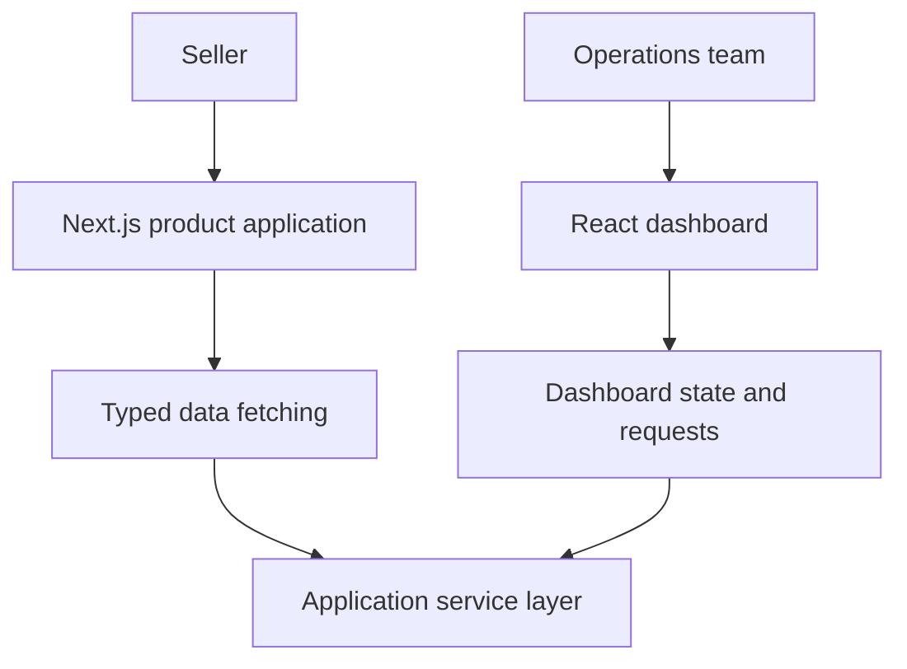
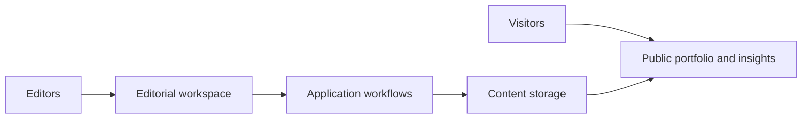

# Architecture at a Glance

A closer look at the patterns behind selected products, from multi-interface web applications to content publishing and commerce discovery.

## Traffmint: Customer and operations interfaces

Traffmint's customer-facing application and administrative dashboard serve different users and workflows.

**Engineering focus:** separating user experiences, handling asynchronous data, validation, and designing maintainable frontend boundaries.

[Read the Traffmint case study](../case-studies/modern-product-platform.md)

## Innovvo Tech: Content and product publishing

The public portfolio and editorial workflows connect through server-side application logic and persistent content.

**Engineering focus:** App Router design, content lifecycles, publishing workflows, and separating editorial changes from application releases.

[Read the Innovvo Tech case study](../case-studies/technology-studio.md)

## Meenahfection Store: Social-to-store discovery

A customer arriving from a social post should be able to reach the product they came to find.

**Product focus:** mobile-first navigation, campaign destinations, consistent product information, and clear ordering paths.

[Read the Meenahfection case study](../case-studies/retail-discovery.md)

---

*Diagrams are simplified illustrations of system responsibilities, not internal infrastructure maps.*

[← Explore the full portfolio](../README.md)
