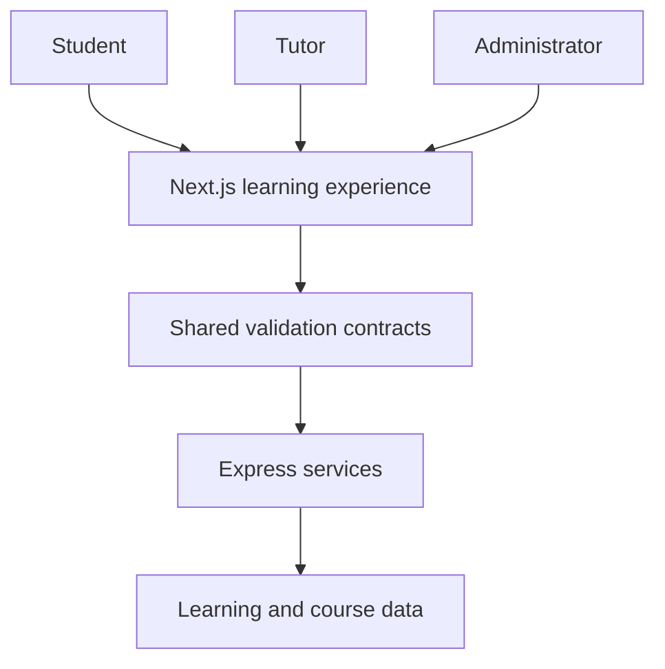
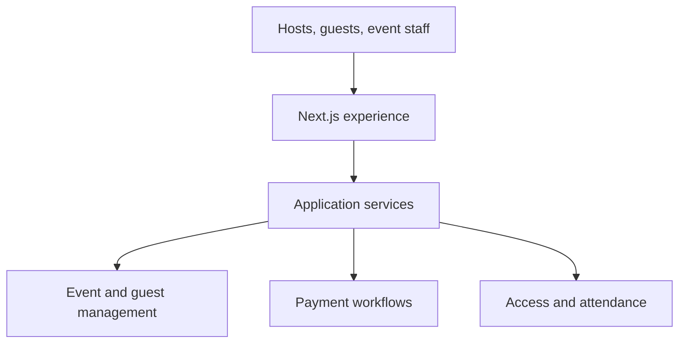
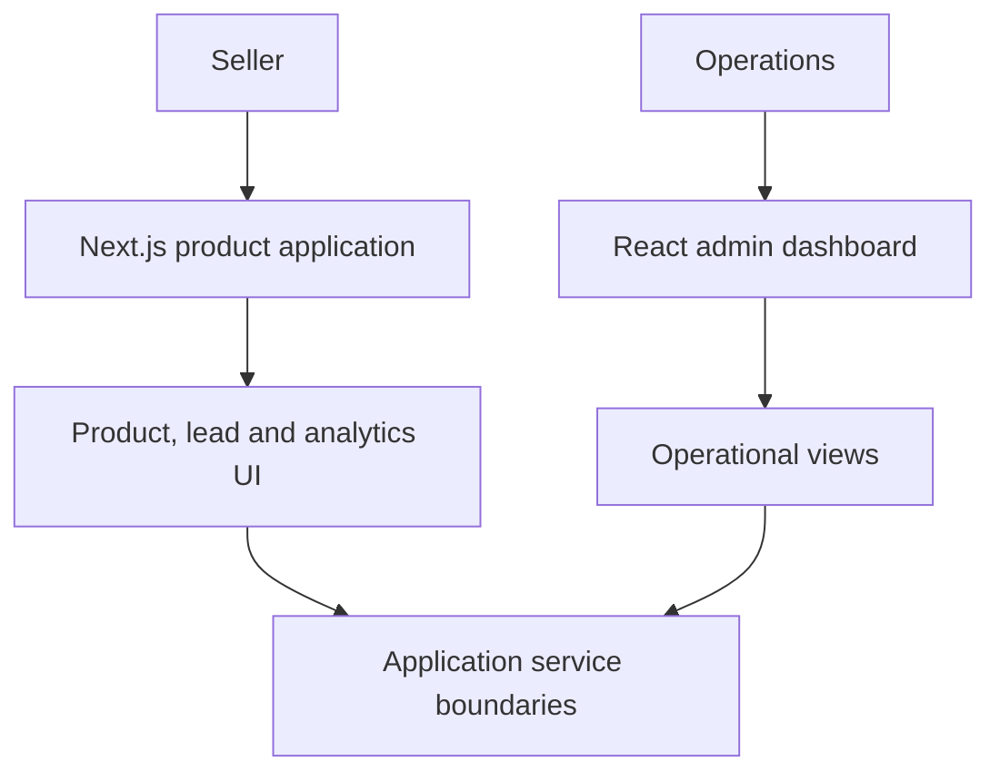

# Architecture at a Glance

Selected system-design decisions from my product work. These diagrams explain **responsibilities and user journeys**, rather than deployment infrastructure.

## OpenMadrasah: Learning, teaching, and review

A shared learning platform serves three roles without mixing their responsibilities.

**Focus:** role-based workflows, shared data contracts, course publication review, and progress-aware learning.

[OpenMadrasah engineering case study](../case-studies/openmadrasah.md)

## PartyDey: Hosting, payments, and event access

An event workflow has to connect digital coordination with on-site operations.

**Focus:** service boundaries, reliable state transitions, payment recovery, and guest admission decisions.

[PartyDey engineering case study](../case-studies/partydey.md)

## Traffmint: Seller and administration interfaces

Seller workflows and operational dashboards have different needs, even when they are part of one product.

**Focus:** separate user experiences, typed asynchronous data, and analytics-oriented presentation.

[Traffmint engineering case study](../case-studies/modern-product-platform.md)

## More engineering work

- [Innovvo Tech: editorial content and publishing workflows](../case-studies/technology-studio.md)
- [Meenahfection Store: social-to-store product discovery](../case-studies/retail-discovery.md)
- [Engineering practices: testing and release quality](../case-studies/quality-and-testing.md)

*Architectures are simplified for public presentation.*

[← Explore the full portfolio](../README.md)
