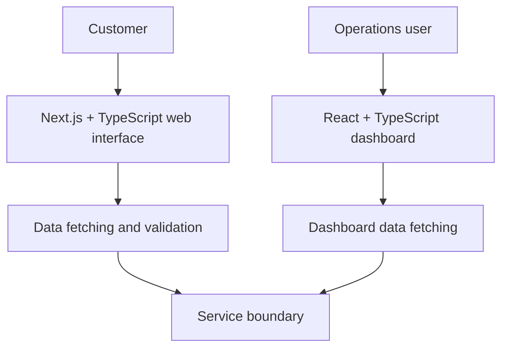

# Architecture notes

These are **conceptual diagrams** attached to [recent product case studies](../README.md). They explain responsibilities and boundaries at a level suitable for a public engineering portfolio.

They are **not** production network maps, security diagrams, or disclosures of private repository structure.

## Customer-facing product and operations

**Engineering focus:** Different user journeys, shared conceptual contract boundaries, typed data, asynchronous state, and error handling.

[Read the case study](../case-studies/modern-product-platform.md)

## Editorial publishing platform

**Engineering focus:** Application code versus editable content, publication states, data ownership, and release checks.

[Read the case study](../case-studies/technology-studio.md)

## Commerce discovery journey

**Product focus:** Stable campaign destinations, mobile usability, consistent listings, and clear calls to action.

[Read the case study](../case-studies/retail-discovery.md)

## Responsible public documentation

No secret values, internal service addresses, credentials, database schemas, access controls, unreleased features, or client records are included. The diagrams are deliberately simplified for communication, not operational reconstruction.
