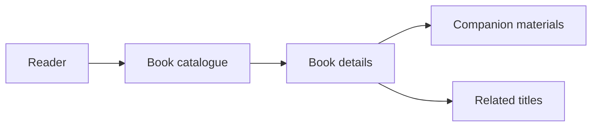

# Innovvo Books: Digital Publishing and Reader Experience

**Publishing technology · Product UX · Learning resources**

Innovvo Books explores how a book can become the starting point for a richer reading experience, with clear discovery pages and relevant companion materials.

## The challenge

A reader who discovers a title may also want to learn more about it, explore related books, or find activities associated with the content. Those needs can get lost when information lives in separate places.

## The product approach

The frontend work covers:

- A browsable book catalogue
- Individual book detail experiences
- Companion activity pages for selected titles
- Reader-focused information and community pathways

These elements support discovery without overwhelming visitors with unnecessary steps.

## Reader journeys

## Design priorities

**Clarity first.** Make it easy to understand who each book is for and what it offers.

**Useful extras.** Connect readers to activities or resources that extend the original material.

**Consistent presentation.** Structure content so additional titles can be introduced without redesigning the entire experience.

The repository originally documented a frontend preview; this case study focuses on the product design and publicly describable work rather than asserting a particular live release status.

[← All projects](../README.md)
