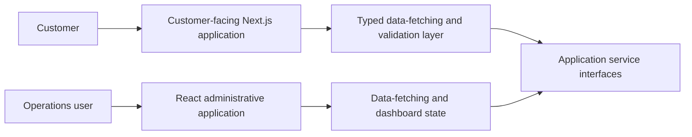

# Case study: Customer product and operations dashboard

**Discipline:** Frontend architecture · Async data · TypeScript  
**Evidence:** Private application package manifests and selected frontend modules reviewed in November 2026  
**Source availability:** Private; architecture below is an abstraction, not a copy of internal infrastructure.

## The engineering problem

A customer-facing web product and an operational dashboard have different navigation, access, and interaction requirements. Treating them as separate applications can make their responsibilities clearer, while introducing a need for disciplined API contracts.

## Verified implementation footprint

| Customer experience | Operational experience |
| --- | --- |
| Next.js, React, TypeScript | React, Vite, TypeScript |
| TanStack Query, Axios | TanStack Query, Axios |
| Zod validation | React Router and Tailwind CSS |
| Route-oriented pages and product flows | Dashboard-style navigation and data-driven views |

These technologies were verified from source manifests. This table describes frontend scope and **does not assert** that both apps share a specific backend, deployment, database, or authentication provider.

## Architectural view

*Conceptual frontend integration diagram. Service interfaces represent boundaries, not a published system topology.*

## Engineering decisions worth discussing

### Separate user journeys

Different user groups need different information density and interaction patterns. The public-facing experience prioritizes clear user journeys, while the administration experience requires efficient navigation around operational data.

### Server state is not UI state

The applications use TanStack Query. In an interview, useful topics include caching, stale data, invalidation, failure states, and why remote data should not automatically be treated like local component state.

### Validate at boundaries

The customer-facing project's dependency manifest includes Zod. Schema validation is relevant where user input or API data crosses a trust boundary. This is a technical capability present in the stack, not a claim that every endpoint is comprehensively validated.

## Review conversation

- How do you decide when to split a product into separate frontends?
- What does a consistent data-fetching and error-handling strategy look like?
- Where should runtime validation happen in a TypeScript application?
- How would you keep two interfaces coherent without over-coupling them?

## Evidence and limits

This case study is grounded in verified dependencies and selected modules. Runtime performance, availability, test coverage, business impact, and security properties were **not independently measured**. No client data or proprietary source is published.

[← Engineering portfolio](../README.md)
