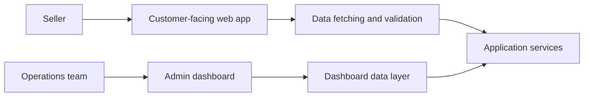

# Traffmint: Social Commerce Platform

**Product engineering · Frontend architecture · Business operations**

Traffmint is designed to bring the scattered parts of social selling into a more connected workflow. Sellers need to manage products, promote their offers, and understand what happens after a link is shared.

[Explore Traffmint](https://innovvo-tech.vercel.app/products/traffmint)

## The challenge

Social-commerce workflows frequently spread across storefronts, promotional links, messaging channels, and dashboards. This makes it harder to connect campaign activity with the products being sold.

## The product approach

The engineering work includes two distinct web experiences:

- **Customer-facing application:** a Next.js and TypeScript interface for the main product experience
- **Operations dashboard:** a React, Vite, and TypeScript application for administration and reporting workflows

The repositories use TanStack Query and Axios for asynchronous data handling. The customer application also includes Zod for runtime validation.

## Architecture at a glance

## Engineering highlights

**Two experiences, different priorities.** The seller-facing product and operational dashboard are organized as separate interfaces, allowing navigation and interactions to suit their users.

**Predictable data handling.** Typed interfaces, asynchronous state management, and request validation help structure complex frontend workflows.

**Room to evolve.** The application separation supports product development without forcing all user journeys into one UI.

## Technology

**Next.js · React · TypeScript · Vite · TanStack Query · Axios · Zod · Tailwind CSS**

[← All projects](../README.md)
