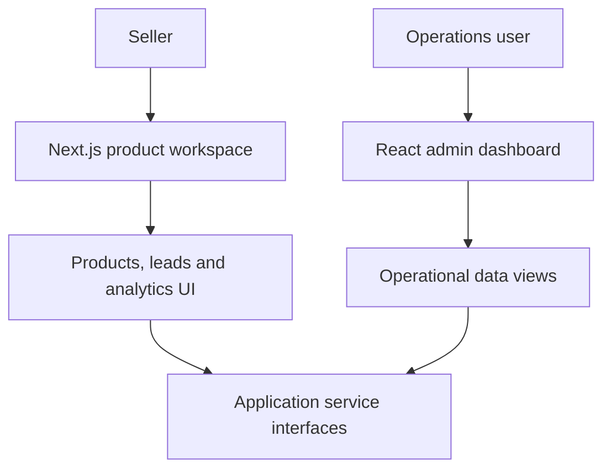

# Traffmint: Connecting Social Commerce with Measurable Workflows

**Social commerce · Product engineering · Data-rich frontend systems**

**[Explore Traffmint](https://innovvo-tech.vercel.app/products/traffmint)**

## The problem

For a social seller, the customer journey is rarely contained in one place. Interest may begin with a post, move through a message or a promotional link, and end with a sale. Products, conversations, leads, campaigns, and performance data can become difficult to connect.

Traffmint is designed around a clearer working cycle: **organize products, promote them, and understand the resulting activity**.

## The product

The inspected product application contains interfaces for:

- **Store and product management**, including product creation and editing.
- **Lead management**, giving sellers a dedicated place to work with potential customers.
- **Store analytics**, presenting business and promotion-related data in one workspace.
- **Social-channel workspaces**, with areas for publishing and dashboard experiences.
- **Administrative operations**, separated into their own dashboard application.

These are code-backed application areas. Their presence does not, by itself, establish that every external social integration is currently active for all users.

## Architecture: two products, different jobs

The seller application uses **Next.js, React, and TypeScript**, while a separate administrative interface uses **React, Vite, and TypeScript**. Both include asynchronous data-access tooling.

This logical diagram highlights the separation of responsibilities rather than private deployment or network configuration.

## Engineering decisions that matter

### 1. Treat the store as an operating workflow

Product management, lead follow-up, and analytics belong together from the seller's perspective. Dedicated modules for **products, leads, store overview, and analytics** create a path from item management to interpreting customer activity.

### 2. Build useful reporting interfaces

The analytics code includes calculations and views for campaign or promotion-related activity, while the store overview brings together important business metrics. The interesting engineering work is not just drawing charts: it is shaping data into understandable information, handling empty states, and keeping interpretation consistent across screens.

These are software interfaces, not a published claim that a particular conversion increase has been measured.

### 3. Make asynchronous interfaces predictable

The product stack includes **TanStack Query, Axios, and Zod**, alongside typed React components. These tools support clear boundaries between user interactions, remote data, and validation rules.

They are especially relevant for interfaces that refresh lists, create records, change filters, or present analysis assembled from multiple data sources.

### 4. Keep operations separate from the seller journey

The dedicated **Vite-based administration dashboard** has its own navigation and data views. That separation creates room for administration workflows without forcing every internal function into the experience used by sellers.

### 5. Design across channels without assuming every channel behaves alike

The application has distinct surfaces for multiple social networks. Supporting channel-specific behavior alongside a common product experience is an architectural challenge involving data contracts, UI state, and error handling.

## Engineering scope

**Next.js · React · TypeScript · Vite · TanStack Query · Axios · Zod · Tailwind CSS · Data visualization · Dashboard architecture**

The codebase contains substantial product, lead, reporting, and administration interfaces. This review documents those implementation surfaces; it does not claim independently verified revenue uplift, complete integrations, or production test coverage.

## What this project demonstrates

Traffmint brings together **commerce-oriented product thinking, multi-application frontend architecture, stateful workflows, and analytical interfaces**. It shows how engineering can turn disconnected selling tasks into a more coherent working environment.

[View the product overview](https://innovvo-tech.vercel.app/products/traffmint) · [Explore the portfolio](../README.md)
