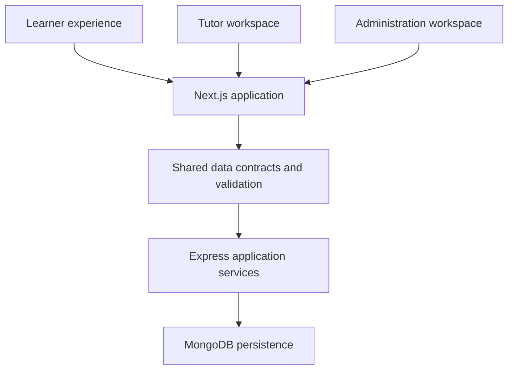

# OpenMadrasah: Building a Learning Platform Across Three Roles

**Education technology · Full-stack development · Learning workflows**

**[Explore OpenMadrasah](https://www.openmadrasah.com/)**

## The problem

Learning Arabic and Islamic studies online often means moving between disconnected videos, notes, chat groups, and course links. Students can lose their place, while educators need a dependable process for building lessons and making them available.

OpenMadrasah brings those journeys together in a structured learning platform for **students, tutors, and administrators**.

## The product

- **Students** can discover subjects, enroll in courses, follow lessons, and continue their learning progress.
- **Tutors** can prepare courses and lessons, attach learning resources, and submit material for review.
- **Administrators** have dedicated workflows for reviewing tutors, courses, and published learning content.
- **Learning content** supports video, audio, PDF, and text-based lessons.

These journeys are presented on the public site and represented in the application code.

## A full-stack architecture built around clear responsibilities

The project uses a **pnpm monorepo** with a Next.js frontend, a modular Express/TypeScript backend, and a shared package of **Zod schemas and data-transfer contracts**. Shared contracts make it easier to keep client forms and API expectations aligned as the learning workflows evolve.

The frontend uses **TanStack Query, React Hook Form, and Zod** for data fetching and form handling. The backend organizes domain functionality into services and modules for learning content, enrollment, user access, and platform operations.

## Engineering decisions that matter

### 1. Teaching privileges require a review process

A learner can apply to teach without automatically becoming an approved tutor. Dedicated onboarding and verification rules distinguish account registration, tutor applications, and approved teaching access.

The codebase includes tests for incomplete tutor submissions, changes to teaching preferences, and attempts to elevate privileges outside the intended workflow.

### 2. A lesson draft is not necessarily a published lesson

Preparing educational material and making it available to learners are separate operations. The lesson-review flow supports drafts and review decisions while keeping unpublished material distinct from approved content.

Tests address the behavior of pending revisions, restrictions on approving one's own submission, and protection of existing published material during review.

### 3. Learning progress is part of the product, not an afterthought

Courses, lessons, enrollment, and progress are modeled as distinct concerns. Students should be able to return to a learning pathway rather than restart their journey from a list of unrelated resources.

### 4. Multilingual teaching needs explicit data rules

The application includes instructional-language preferences and validation for supported and custom languages. This makes it possible to describe a course's teaching language separately from the tutor's personal profile.

## Quality and verification

The backend includes **Vitest** test suites for areas such as enrollment, email verification, tutor permissions, lesson review, and account management, alongside **Supertest** as an integration-testing dependency.

Those tests demonstrate the kinds of rules the project is designed to protect. They are not presented here as a fresh passing test report or a claim of complete coverage.

## Technology

**Next.js · React · TypeScript · Tailwind CSS · Express · MongoDB/Mongoose · Zod · TanStack Query · React Hook Form · Vitest**

## What this project demonstrates

OpenMadrasah combines a public learning experience with **role-specific workflows, cross-application data contracts, content approval, and progress-aware design**. It shows the engineering involved in turning an educational idea into a maintainable multi-user web product.

[Visit the live platform](https://www.openmadrasah.com/) · [Explore the portfolio](../README.md)
