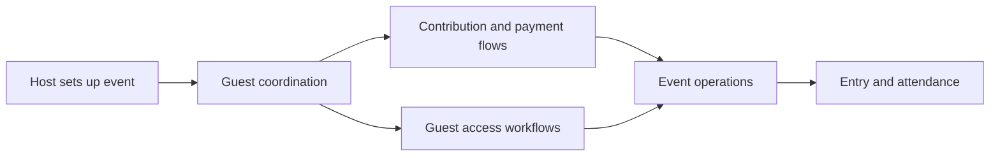
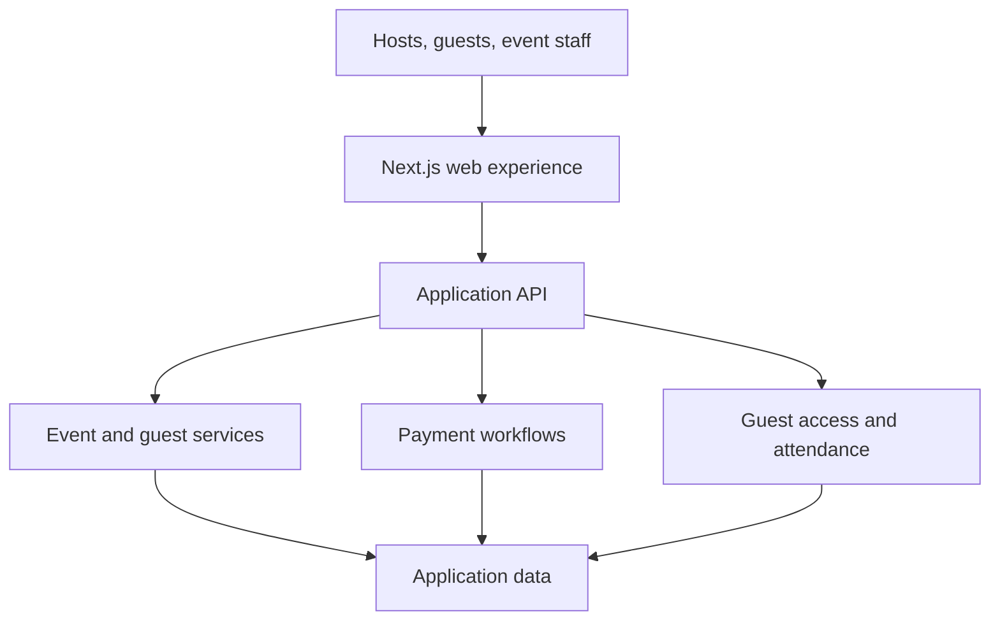

# PartyDey: Engineering an End-to-End Event Operations Platform

**Event technology · Full-stack engineering · Transactional workflows**

**[Explore PartyDey](https://www.partydey.com/)** · **[Product overview](https://innovvo-tech.vercel.app/products/partydey)**

## The problem

Organizing an event often involves several disconnected jobs: collecting contributions, recording payments, inviting guests, assigning responsibilities, and managing entry on the event day. Each handoff creates more room for confusion.

PartyDey brings **event hosting, payments, guest operations, and access management** into a connected product journey.

## The product

The application provides different experiences for the people involved:

- **Hosts** work with event setup, guest coordination, payments, and day-of-event operations.
- **Guests** can interact with relevant event pages, invitations, and access experiences.
- **Event staff** have operational tools for admission and attendance workflows.
- **Administrators** have dedicated management views.

The frontend code includes route groups and components for these distinct experiences. The backend organizes functionality by domain rather than treating every operation as a generic endpoint.

## From planning to check-in

This is a product journey diagram. Individual paths vary by event and its configuration.

## Engineering architecture

The web application uses **Next.js, React, and TypeScript**. A separate **Express** service organizes business logic into focused modules, supported by **MongoDB/Mongoose**, schema validation, and request-level middleware.

A simplified view:

The separation helps keep user-interface concerns distinct from rules governing event state, payment processing, and admission decisions.

## Engineering challenges

### 1. Payments can be confirmed more than once

Payment providers, browser confirmations, and recovery mechanisms may all report progress on the same payment. A reliable system must avoid treating a repeated notification as a second successful payment.

The backend includes tests addressing **webhook replay, payment-state transitions, group-payment finalization, and retry behavior**. These are important examples of correctness rules that should be tested at the service boundary rather than left to frontend behavior.

### 2. An access pass is more than a QR image

Admission depends on the event, the status of a credential, the gate's policy, and existing attendance state. The application has distinct access verification and attendance services rather than relying solely on the presentation of a code.

The test suites cover conditions including **invalid or revoked passes, duplicate scans, event mismatches, and re-entry decisions**.

### 3. Event-day operations need to handle imperfect conditions

A guest might be scanned twice, an interface might retry, or a derived attendance view might temporarily lag behind the underlying record. The codebase includes tests for **concurrent attendance actions and rebuilding attendance views**.

The engineering lesson is that operational workflows need clear authoritative state and explicit recovery behavior.

### 4. One product serves multiple roles

Hosts need a planning workspace, guests need a simple interaction path, and staff need fast operational screens. Organizing these as different experiences makes each journey easier to reason about without duplicating the whole product.

## Quality and release discipline

The repository contains extensive automated tests around access decisions, attendance, payment flows, webhook events, and recovery. It also includes documented preview/release checks. The public case study describes **test scenarios found in the codebase**, not an independent audit of production reliability or a claim that every current check passes.

## Technology

**Next.js · React · TypeScript · Express · MongoDB/Mongoose · Zod · QR-based access interfaces · Automated service and integration tests**

## What this project demonstrates

PartyDey illustrates engineering work where **user experience, financial state, guest identity, and physical event operations intersect**. It shows the value of modular services, carefully modeled state transitions, and testing the difficult paths rather than only the happy path.

[Explore PartyDey](https://www.partydey.com/) · [Explore the portfolio](../README.md)
