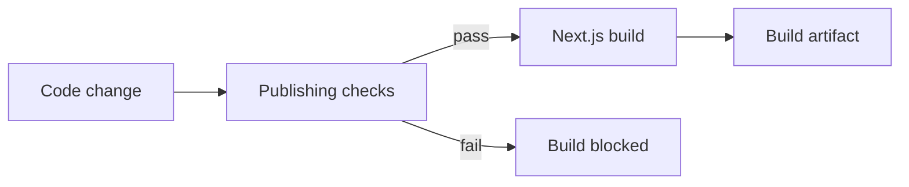

# Case study: Engineering quality and testable publishing workflows

**Discipline:** Application verification · Release checks · Backend/frontend boundaries  
**Evidence:** Private application package manifests and an automated test file reviewed in November 2026  
**Source availability:** Private. This account is about engineering practices, not a published test report.

## Why this work matters

Content sites and reader-facing products can have deceptively complex edge cases. A page may render while a webhook contract is wrong, a subscription path mishandles consent, or a catalogue item is presented incorrectly. These are business-logic risks that deserve explicit checks.

## Verified evidence in project configuration

One recent Next.js codebase defines a production build sequence that **runs a publishing-related test command before building the application**:

*Simplified representation of the package-script sequence. It does not assert that every deployment follows this path or that the latest run passed.*

The repository declares checks concerning these categories:

| Test area | Risk addressed |
| --- | --- |
| Webhook / interface contracts | Incompatible payloads or unexpected request structures |
| Shared publishing logic | Divergent behavior between related workflows |
| Anti-spam controls | Abusive or unintended submissions |
| Email templates | Broken or inconsistent message generation |
| Catalogue rules | Incorrect content or discovery behavior |
| Reader-oriented flows | Broken user journeys or delivery logic |

A reviewed test module uses Node's built-in test and assertion APIs. A separate backend project also declares **Vitest** and **Supertest** as testing tools. The presence of these dependencies alone does not prove the number, quality, or passing status of tests in that second project.

## Engineering approach

- Put checks near the business rules most likely to affect users.
- Validate application behavior at module and integration boundaries.
- Prefer reproducible local tests over claims based solely on screenshots.
- Treat email, consent, and publishing paths as deliberate workflows.
- Keep test environments and records separate from production data.

## What still needs independent verification

- Latest run status and regression history
- Exact test coverage and mutation resistance
- End-to-end behavior against disposable test services
- Accessibility testing and performance budgets
- Failure handling under realistic production load

These are **not presented as completed audits**.

## Questions I can discuss in an interview

1. What should prevent a release when a publishing contract fails?
2. How should email and subscription paths be tested without sending real customer email?
3. Where are unit, integration, and end-to-end tests most valuable?
4. How should external dependencies be isolated in automated tests?
5. What evidence would justify confidence in a release beyond a green build?

[← Engineering portfolio](../README.md)
