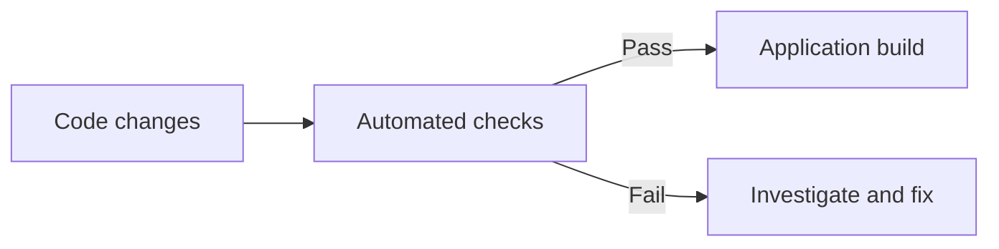

# Engineering Practices: Testing and Release Quality

**Automated checks · Application reliability · Product workflows**

Good software is more than a screen that looks finished. Behind the interface are business rules, integrations, and failure states that need deliberate attention.

## Testing meaningful workflows

In the Innovvo Tech codebase, the build configuration runs publishing-related checks before the Next.js application build.

The project includes checks relating to:

- Publishing and shared application logic
- Catalogue behavior and reader-facing workflows
- Email template generation
- Anti-spam protections and request handling
- Data contracts between connected features

The test modules use Node's test and assertion utilities. Other backend work also uses development tools such as Vitest and Supertest.

## Engineering principles

**Test the workflows that matter.** Prioritize behavior users rely on instead of chasing coverage numbers in isolation.

**Keep changes reviewable.** Separate content updates, code changes, and deployments where each has a different purpose.

**Design for failure.** Loading states, errors, validation, and safe retries are part of the user experience.

**Keep environments separate.** Test with isolated data and avoid using production records for experiments.

## Technologies and practices

**Node.js testing · Test assertions · Integration boundaries · TypeScript · Build checks · Code review**

This overview describes the testing approaches visible in the projects; it is not a published test-coverage report.

[← All projects](../README.md)
