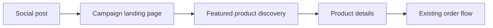

# Case study: Social-to-store retail discovery

**Discipline:** Product UX · Mobile-first frontend journeys · E-commerce  
**Evidence:** Product requirements and implementation discussions; source-level audit not included  
**Source availability:** Private.

## The user problem

A visitor sees a product in a short-form social video, follows a link, and needs to identify the exact product without browsing an unrelated catalogue. If the destination is confusing, interest can disappear before the customer reaches a product page.

## The intended journey

*Journey map, not an audited representation of internal application wiring.*

## Product decisions

1. **One reusable destination.** A channel-neutral “as seen on socials” route avoids creating a new landing page for every marketing platform.
2. **Mobile-first browsing.** The visitor should be able to identify a featured product quickly on a small screen.
3. **Consistent product information.** Product details, available sizes, and prices need to match the actual catalogue.
4. **Direct ordering paths.** The entry page should help users reach existing product detail and checkout processes rather than create a competing purchase workflow.
5. **Measurement without guesswork.** A useful analytics design would distinguish campaign visits, product selections, and downstream conversion events. No conversion-rate improvement is claimed here.

## What I would evaluate

| Question | Possible evidence |
| --- | --- |
| Can a new visitor find a promoted product? | Observed product selection task |
| Is the page usable on narrow screens? | Mobile viewport review |
| Do campaign links reach the right destination? | Link and route checks |
| Can admins distinguish campaign traffic? | Defined event naming and reporting |
| Do listings agree with the catalogue? | Content consistency checks |

The checks above are **evaluation criteria**, not claims that they have already been executed.

## Evidence and limits

This is primarily a user-journey and product-design case study. It should be supplemented with approved real screenshots, implementation evidence, and actual measured outcomes before being treated as a technical source-code case study.

[← Engineering portfolio](../README.md)
