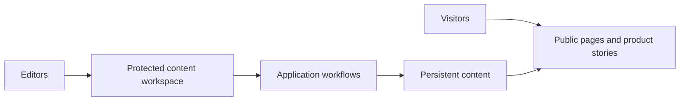

# Innovvo Tech: Product Portfolio and Publishing Platform

**Full-stack development · Content systems · Product engineering**

Innovvo Tech brings multiple digital products, project stories, research, and business inquiries together in one web experience.

[Explore Innovvo Tech](https://innovvo-tech.vercel.app/)

## The challenge

A technology business needs more than a static homepage. Visitors should be able to discover products, explore the problems they solve, review technical work, and find relevant insights without navigating disconnected websites.

## The solution

The platform brings together a product portfolio, individual product pages, editorial updates, opportunity research, and contact workflows.

It also separates public-facing pages from protected editorial operations, allowing site content to change without requiring every update to be made as an application-code deployment.

## Architecture at a glance

## Engineering highlights

**App Router structure.** The site uses Next.js 16, React 19, and TypeScript to organize multiple kinds of content into a coherent product experience.

**Content and code as separate concerns.** Database-backed editorial workflows help keep routine publishing work distinct from the release of application code.

**Checks around important flows.** The project's build configuration includes automated checks for publishing-related behavior before building the Next.js application.

**Product storytelling.** Product profiles and build stories explain not just what a product does, but the problem it is built to address.

## Technology

**Next.js 16 · React 19 · TypeScript · Tailwind CSS · Server-side application logic · PostgreSQL-based content workflows**

[Related: Engineering practices and testing](quality-and-testing.md)

[← All projects](../README.md)
