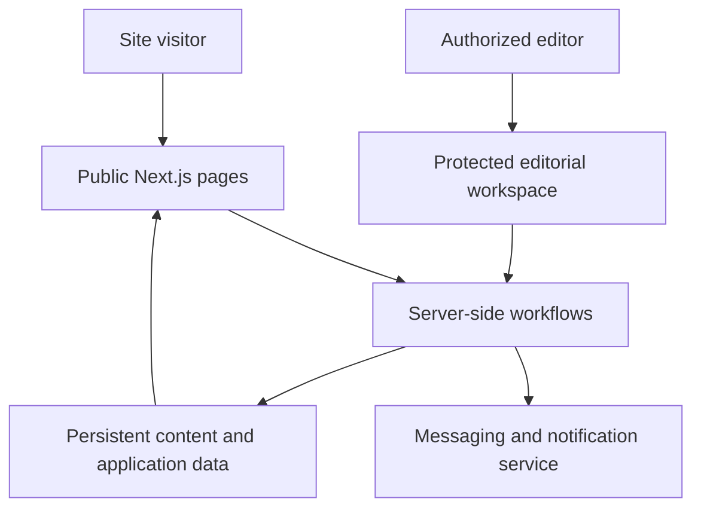

# Case study: Product, content, and publishing platform

**Discipline:** Full-stack web architecture · Content workflows · Reliability  
**Evidence:** Private project README, application dependencies, and build scripts reviewed in November 2026  
**Source availability:** Private; the diagram is deliberately simplified.

## The product challenge

A studio website needs to connect its product portfolio, evidence of work, editorial updates, and inquiry paths. As content grows, the site becomes an application with publishing workflows, rather than a group of static landing pages.

## Verified technical foundation

- **Next.js 16 App Router**, React 19, and TypeScript
- Tailwind CSS for UI presentation
- Application routes for product, work, and editorial content
- Protected editorial/operations scope described in repository documentation
- Server-side services for persistence and communications, described at a high level
- A build script that runs an automated publishing-related test suite before the Next.js build

## Simplified architecture

*Illustrative logical boundaries, not a network, security, or deployment diagram.*

## The interesting engineering decisions

### Content updates should not require code changes

The repository documents a distinction between application code and editable content. This allows product information or editorial state to evolve independently from changes to source code, provided the system enforces appropriate authorization and validation.

### Publishing is a workflow

Content may pass through draft, review, and publication stages. The important engineering questions are who may make transitions, how changes are represented, and what happens when publication fails.

### Test the business-critical edges

The build configuration invokes a test suite covering areas such as publication-related data contracts, catalogue handling, anti-spam checks, email templates, and reader-facing delivery flows. The presence and placement of these checks are verified; **the latest test results and coverage percentages were not established**.

For a closer look at the testing approach, see [Engineering quality and verification](quality-and-testing.md).

## Interview discussion prompts

- Where should content state live, and why?
- How can editorial operations avoid accidentally triggering public releases?
- Which invariants belong in tests around subscriptions and publishing?
- How do you maintain a clear boundary between code deployment and editorial changes?

## Evidence and limits

Architecture and feature scope were derived from repository documentation and manifests. This does not establish production uptime, traffic, commercial outcomes, a completed audit, or verified effectiveness of security controls. Proprietary implementation details are intentionally excluded.

[← Engineering portfolio](../README.md)
